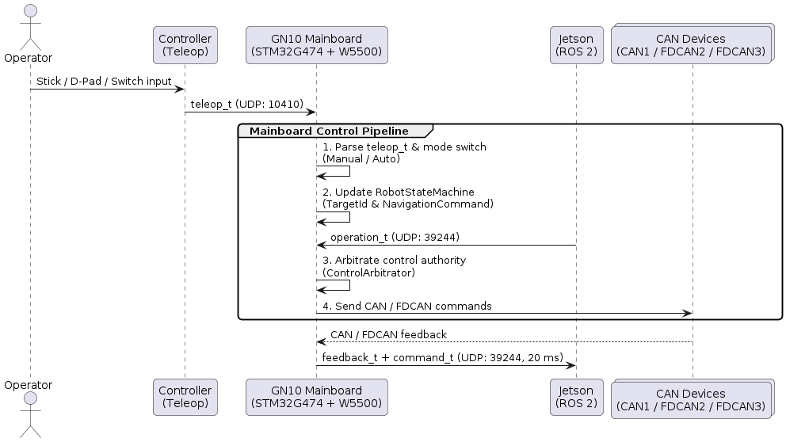
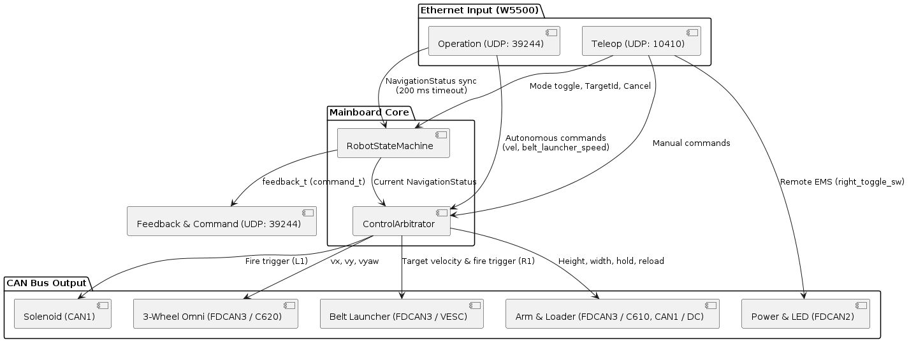
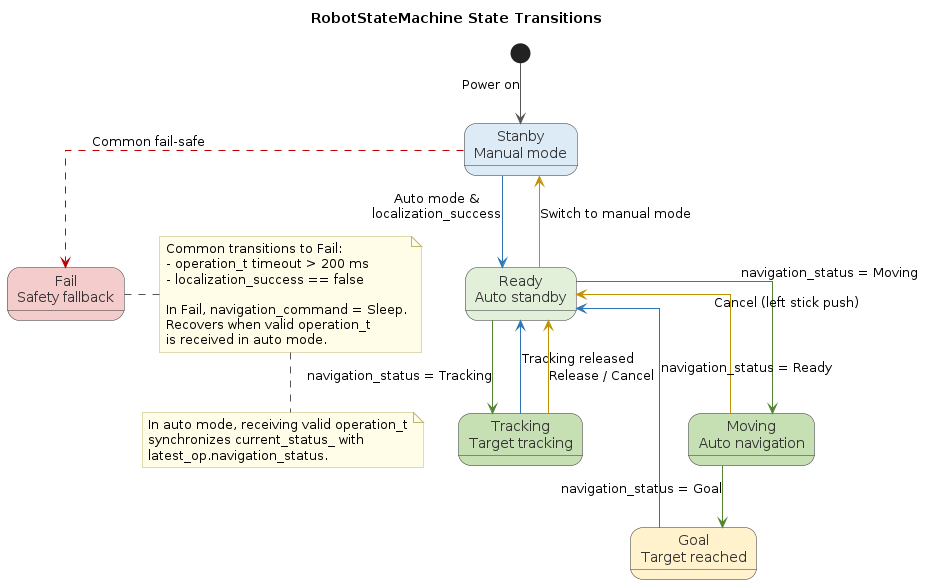

# 2026a-gn10-mainboard

[English](README.md) | [日本語](README_jp.md)

Firmware for [GN10Mainboard](https://github.com/ararobo/GN10Mainboard) (STM32G474 + W5500), serving as the master controller and fail-safe arbiter bridging Ethernet (UDP) and `gn10-can` buses.

## Table of Contents

1. [Overview](#1-overview)
2. [Documents](#2-documents)
3. [Contributing](#3-contributing)
4. [Build & Usage](#4-build--usage)
5. [System Architecture](#5-system-architecture)
6. [License](#6-license)

## 1. Overview

In the robot control architecture, GN10Mainboard acts as the central real-time arbiter between the manual controller, Jetson (ROS 2), and distributed CAN subsystems:

- **Control Arbitration**: Receives manual `teleop_t` and autonomous `operation_t` over UDP, arbitrates authority via `RobotStateMachine` and `ControlArbitrator`, and prioritizes manual override / safety interlocks.
- **Fail-Safe**: Stops all actuators on `teleop_t` timeout (100 ms), falls back to manual mode on `operation_t` timeout (200 ms), and controls remote EMS via `right_toggle_sw`.
- **CAN Bridging**: Drives actuators, power managers, and LED indicators across `FDCAN1`, `FDCAN2`, and `FDCAN3` using `gn10-can`.

## 2. Documents

| Document | Description |
| :-: | :-: |
| [CONTRIBUTING.md](./CONTRIBUTING.md) | Development workflow, commit conventions, and PR rules |
| [docs/coding-rules.md](./docs/coding-rules.md) | Coding style and conventions |
| [docs/auto_mode_specification.md](./docs/auto_mode_specification.md) | Auto mode, state machine, and key configuration |
| [docs/CHANGELOG.md](./docs/CHANGELOG.md) | Release and change history |
| [docs/uml/](./docs/uml/) | PlantUML diagram source files |

## 3. Contributing

Refer to [CONTRIBUTING.md](./CONTRIBUTING.md) for full contribution guidelines.

- **Branch naming**: `feat/<issue-number>-<summary>` / `fix/<issue-number>-<summary>`
- **Commit message**: `feat`, `fix`, `refactor`, `docs`, `chore` (imperative/noun phrase, max 30 chars)
- **Merge condition**: At least 1 approving review and passing CI checks

## 4. Build & Usage

### 4.1 Prerequisites

- CMake 3.22+
- Ninja
- ARM GNU Toolchain (`arm-none-eabi-gcc`)
- STM32CubeProgrammer (`STM32_Programmer_CLI`)

### 4.2 Build

```bash
# Debug build
cmake --preset Debug
cmake --build --preset Debug

# Release build
cmake --preset Release
cmake --build --preset Release
```

### 4.3 Flashing

Connect an ST-Link programmer and flash via VSCode or CLI:

- **VSCode**: `Tasks: Run Task` -> `Flash Firmware (ST-Link)`
- **CLI**:
  ```bash
  STM32_Programmer_CLI -c port=SWD -w build/Release/2026a-gn10-mainboard.elf -v -rst
  ```

### 4.4 Hardware Setup & Indicators

1. **Ethernet (W5500)**:
   - Static IP: `192.168.3.2` (Gateway: `192.168.3.1`)
   - `UDP 10410`: Receives `teleop_t` from `192.168.2.2`
   - `UDP 39244`: Receives `operation_t` from `192.168.3.1` / sends `feedback_t` (including `command_t`) every 20 ms
2. **CAN Buses (`gn10-can`)**:
   - `FDCAN1` (Classic CAN): Solenoid Driver (ID 0), Arm Height DC Motor Driver (ID 0)
   - `FDCAN2` (CAN FD): Drive Power Manager (ID 0), Logic Power Manager (ID 1), LED Board (ID 2)
   - `FDCAN3` (CAN FD): Belt Launcher VESC Hub (ID 0), Wheel ESC Hub (ID 1), Arm/Loading ESC Hub (ID 2)
3. **Status LEDs**:
   - `LED_BLUE`: Heartbeat (toggles every 500 ms)
   - `LED_RED`: ON if W5500 initialization fails

## 5. System Architecture

### 5.1 System Data Flow

End-to-end communication flow between Teleop, Mainboard, Jetson (ROS 2), and CAN devices.


*(PlantUML source: [system_data_flow.pu](./docs/uml/system_data_flow.pu))*

### 5.2 Control Arbitration

Internal arbitration between manual Teleop input and autonomous Jetson operation commands.


*(PlantUML source: [internal_arbitration.pu](./docs/uml/internal_arbitration.pu))*

### 5.3 State Machine

State transitions managed by `RobotStateMachine` for manual, auto standby, navigation, tracking, and fail-safe fallback.


*(PlantUML source: [state_machine.pu](./docs/uml/state_machine.pu))*

## 6. License

This repository is licensed under the [MIT License](./LICENSE).
