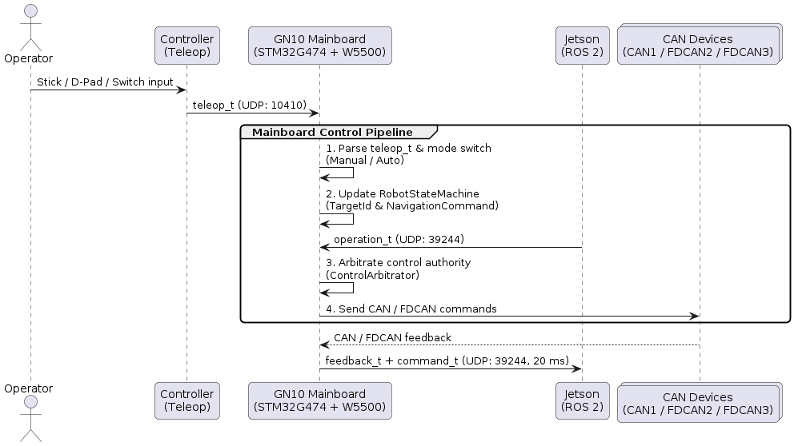
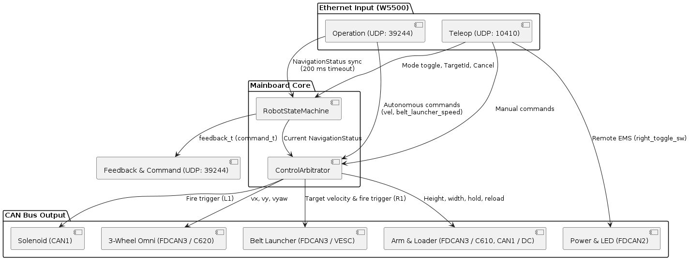
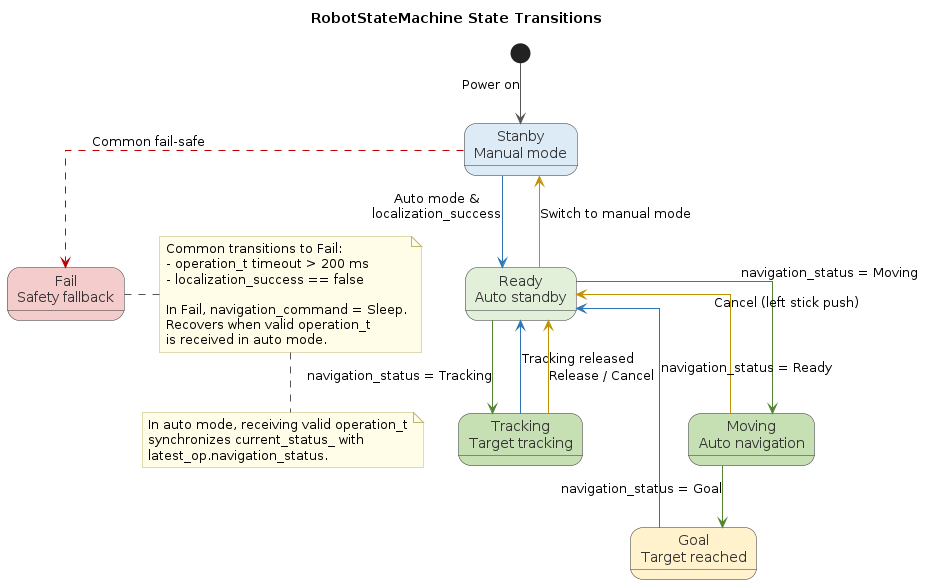

# 2026a-gn10-mainboard

[English](README.md) | [日本語](README_jp.md)

[GN10Mainboard](https://github.com/ararobo/GN10Mainboard)（STM32G474 + W5500）用のファームウェア。Ethernetと`gn10-can`を中継し、ロボット全体の制御調停とフェールセーフを担う。

## 目次

1. [概要](#1-概要)
2. [ドキュメント](#2-ドキュメント)
3. [コントリビューション](#3-コントリビューション)
4. [ビルド・使い方](#4-ビルド使い方)
5. [システム構成](#5-システム構成)
6. [ライセンス](#6-ライセンス)

## 1. 概要

ロボット制御系統の中枢として、手動コントローラ、Jetson上のROS 2、各CANデバイス間を統合する。

- **制御権限の調停**: UDP経由の手動指令`teleop_t`と自動指令`operation_t`を受信し、`RobotStateMachine`と`ControlArbitrator`で操作権限を調停する。
- **フェールセーフ**: `teleop_t`の100 msタイムアウトで全アクチュエータを停止し、`operation_t`の200 msタイムアウトで手動モードへフォールバックする。`right_toggle_sw`による非常停止制御も行う。
- **CAN通信中継**: `gn10-can`を用いて`FDCAN1`、`FDCAN2`、`FDCAN3`上の各基板へ指令を送信する。

## 2. ドキュメント

| ドキュメント | 説明 |
| :-: | :-: |
| [CONTRIBUTING.md](./CONTRIBUTING.md) | 開発フロー・コミット規約・コーディング規約 |
| [docs/coding-rules.md](./docs/coding-rules.md) | コーディング規約 |
| [docs/auto_mode_specification.md](./docs/auto_mode_specification.md) | 自動モード・状態遷移・キーコンフィグ仕様 |
| [docs/CHANGELOG.md](./docs/CHANGELOG.md) | 変更履歴 |
| [docs/uml/](./docs/uml/) | PlantUMLソースファイル |

## 3. コントリビューション

詳細は [CONTRIBUTING.md](./CONTRIBUTING.md) を参照。

- **ブランチ命名**: `feat/<issue番号>-<概要>` / `fix/<issue番号>-<概要>`
- **コミットメッセージ**: `feat`, `fix`, `refactor`, `docs`, `chore`（体言止め・30文字以内）
- **マージ基準**: レビュー1名以上の承認およびCI通過

## 4. ビルド・使い方

### 4.1 必要環境

- CMake 3.22 以上
- Ninja
- ARM GNU Toolchain (`arm-none-eabi-gcc`)
- STM32CubeProgrammer (`STM32_Programmer_CLI`)

### 4.2 ビルド手順

```bash
# Debug ビルド
cmake --preset Debug
cmake --build --preset Debug

# Release ビルド
cmake --preset Release
cmake --build --preset Release
```

### 4.3 書き込み

ST-Linkを接続し、以下のいずれかで書き込む。

- **VSCode**: `Tasks: Run Task` -> `Flash Firmware (ST-Link)` を実行
- **CLI**:
  ```bash
  STM32_Programmer_CLI -c port=SWD -w build/Release/2026a-gn10-mainboard.elf -v -rst
  ```

### 4.4 ハードウェア設定・動作仕様

1. **Ethernet**:
   - 固定IP: `192.168.3.2`（ゲートウェイ: `192.168.3.1`）
   - `UDP 10410`: `192.168.2.2`から`teleop_t`を受信
   - `UDP 39244`: `192.168.3.1`から`operation_t`を受信、`command_t`を含む`feedback_t`を20 ms周期で送信
2. **CANバス**:
   - `FDCAN1`: 電磁弁ドライバ（ID 0）、アーム昇降用DCモータドライバ（ID 0）
   - `FDCAN2`: 駆動用電源管理基板（ID 0）、制御用電源管理基板（ID 1）、LED基板（ID 2）
   - `FDCAN3`: 射出用VESCハブ（ID 0）、足回り用ESCハブ（ID 1）、アーム・装填用ESCハブ（ID 2）
3. **ステータスLED**:
   - `LED_BLUE`: ハートビート（500 ms周期でトグル）
   - `LED_RED`: W5500初期化失敗時に点灯

## 5. システム構成

### 5.1 システム間データフロー

コントローラ、メイン基板、Jetson、各CANデバイス間の通信フローを示す。


*(PlantUMLソース: [system_data_flow.pu](./docs/uml/system_data_flow.pu))*

### 5.2 内部調停アーキテクチャ

手動指令と自動指令の調停構成を示す。


*(PlantUMLソース: [internal_arbitration.pu](./docs/uml/internal_arbitration.pu))*

### 5.3 状態遷移

`RobotStateMachine`による状態遷移を示す。


*(PlantUMLソース: [state_machine.pu](./docs/uml/state_machine.pu))*

## 6. ライセンス

本リポジトリは [MITライセンス](./LICENSE) のもとで公開されている。
